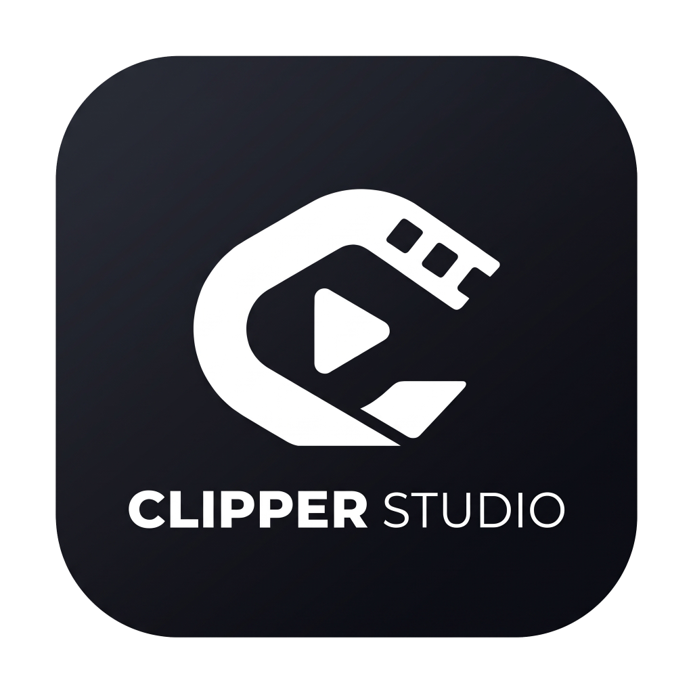

<p align="center">
  
</p>

<h3 align="center">All-in-one desktop studio for video clipping and autonomous talking-head creation.</h3>

<p align="center">
  Cut viral clips from long-form streams or turn raw talking-head footage into polished, broadcast-grade vertical reels on your own computer.
  Transcription runs offline with Whisper; editorial planning uses the AI CLI you're already logged in to, local models (Ollama / LM Studio), or your own API key.
</p>

<p align="center">
  <a href="LICENSE"></a>
  <a href="https://github.com/lrmn7/clipper-studio/releases"></a>
</p>

---

## Two Dedicated Studios in One Desktop App

ClipperStudio combines two production-grade workflows into a single fast, native desktop app:

1. **Video Clipper Studio**: Paste a YouTube, Twitch, or local video link, add campaign brief requirements (target topics, hook style, banned words), and ClipperStudio finds the best viral moments, crops them to 9:16 or 16:9, and burns in synchronized, animated word-by-word captions.
2. **Talking Head Director Studio**: Import raw single-take or multi-take talking-head footage. The Autonomous AI Director trims dead air, tracks facial framing with YuNet, generates contextual motion graphics (hook cards, data comparisons, headlines, checklists, liquid glass graphs), layers elements behind the speaker with MediaPipe segmentation, and enforces social safe zones for TikTok, Instagram Reels, and YouTube Shorts.

---

## Why ClipperStudio?

- **Built for clippers and creator campaigns.** Paste campaign briefs (brand mentions, required talking points, tone, constraints) and ClipperStudio selects only compliant moments. Clips that break campaign rules are automatically excluded.
- **Autonomous Talking Head Director.** Turn raw, unedited camera footage into high-retention short-form videos with zero manual timeline chopping. The AI director detects topic shifts, questions, data comparisons, and emphatic punchlines to place graphics with editorial restraint.
- **Face Protection & Anti-Occlusion Engine.** Real-time YuNet face tracking and MediaPipe segmentation ensure cards, text, B-roll, and subtitles **never cover the speaker's face**. Overlay graphics automatically yield to the speaker's facial zone or tuck cleanly behind their head.
- **Universal Social Safe Zone Compliance.** All titles, cards, and subtitles are anchored strictly within the universal safe zone (13.5% top margin, 77.2% bottom margin), ensuring no content is blocked by TikTok, Reels, or Shorts UI headers, usernames, or interaction buttons.
- **13 Signature Editorial Styles.** Automatically selects or customizes the aesthetic based on your topic: Vox-Style Editorial Magazine, High-Retention Creator, Brutalist Documentary, Apple Glass Fintech, Kinetic Viral, Minimalist Wellness, Cyberpunk Tech, Dark Mode SaaS, and more.
- **Preview-First Gate.** Inspect your talking-head video before rendering: generate an instant 540p proxy preview video and an 8-up keyframe contact sheet, then fine-tune segments and toggle 3D Behind-Head Depth Masking in the Part Editor.
- **Offline transcription.** Whisper (`whisper.cpp`) runs locally on your CPU or GPU. Download a model once; your audio and footage never leave your machine.
- **Use the AI you already pay for.** Automatically detects logged-in CLIs including Claude Code, Codex, Antigravity, Grok, Cursor, OpenCode, and Gemini CLI. You can also use your own OpenRouter, Anthropic, or OpenAI API keys.
- **100% offline local AI support.** Point ClipperStudio to your own local LLM server (Ollama, LM Studio, llama.cpp, vLLM, or any OpenAI-compatible API). Planning never leaves your local network and incurs zero API costs.
- **No accounts, telemetry, or cloud backend.** ClipperStudio does not run a server. Your footage, transcripts, and credentials stay strictly on your machine.
- **Captions that look native.** 9 clip caption presets (Viral, Hormozi, Bold, Clean, Minimal, Fire, Glow, Neon, Karaoke) plus word-by-word animated talking-head typography (clean, bold, pill, grey).
- **MIT licensed.** Open-source, hackable, and free forever.

---

## How It Works

### Workflow 1: Long-Form Video Clipper

```
 Source Video ──▶ Download ──▶ Transcribe ──▶ AI Moments ──▶ Smart Framing ──▶ Render
 (URL or file)     yt-dlp       Whisper       your AI CLI     YuNet auto-crop    FFmpeg
                                (local)       or local LLM    9:16 or 16:9       9 styles
```

- **Step 1: Video Source** — Input a YouTube URL, Twitch VOD, or local video file. Optionally set a trim range.
- **Step 2: Campaign Brief** — Specify brand requirements, talking points, tone, and banned topics.
- **Step 3: Format & Speed** — Choose 9:16 vertical (with smart speaker framing) or 16:9 landscape. Select playback speed (1×, 1.1×, 1.25×, 1.5×, 1.75×, 2×) with pitch-preserved audio.
- **Step 4: Clip Selection** — Let the AI discover high-retention moments, or switch to manual timecodes (`m:ss`).
- **Step 5: Captions & Review** — Choose from 9 animated caption presets with live preview before rendering.

### Workflow 2: Talking Head Director

```
 Raw Footage ──▶ YuNet Track ──▶ Transcribe ──▶ AI Director ──▶ Preview Gate ──▶ 1080x1920
 (camera file)    & Segmentation  Whisper       editorial plan   540p proxy &     broadcast
                                                & 3D layers      Part Editor      master
```

- **Step 1: Raw Footage Source** — Select a single video file or a multi-take recording folder.
- **Step 2: Creative Direction** — Choose **Autonomous AI Director** (auto-analyzes speech, pacing, dead air, and matches aesthetic) or **Custom AI Prompt** (guided aesthetic direction). Optionally enable **Clean Audio (Zero-SFX Mode)**.
- **Step 3: Preview-First Gate** — Review the plan:
  - 🎬 **Play 540p Proxy Video**: Fast low-res preview rendering in seconds.
  - 🖼️ **Open Keyframe Contact Sheet**: High-res composite sheet showing every graphic beat.
  - 🛠️ **Part Editor**: Inspect each segment timestamp, edit headline/card copy, and toggle **Behind-Head 3D Depth Masking**.
- **Step 4: Broadcast Master Render** — Click **Render Broadcast Master** to export the final 1080x1920 60/30fps vertical video with burned-in motion graphics, depth layers, and sound effects.

---

## App Navigation & Shortcuts

| Page | Shortcut | Purpose |
| --- | --- | --- |
| **Create** | `Ctrl + 1` | Long-form video clipping wizard (Source → Brief → Format → Clips → Captions) |
| **Library** | `Ctrl + 2` | Browse completed clips, view virality scores, timecodes, tags, and reveal files in Explorer/Finder |
| **Jobs** | `Ctrl + 3` | Monitor active rendering tasks, background job queues, and export logs |
| **Talking Head Editor** | `Ctrl + 4` | Autonomous AI director, raw footage reframing, 3D depth masking, and proxy review |
| **Settings** | `Ctrl + ,` | AI providers, local server endpoints, Whisper model catalog, and system health checks |

---

## Download & Setup

Download prebuilt binaries from [GitHub Releases](https://github.com/lrmn7/clipper-studio/releases):
- **macOS**: DMG for Apple Silicon (M1/M2/M3/M4)
- **Windows**: Zip package for Windows 10/11 (x64)
- **Linux**: Tarball for Linux (x64)

Each release bundles FFmpeg and yt-dlp.

### First-Launch Configuration

1. **Pick an AI Provider**:
   - **Detected CLI**: If you use Claude Code (`claude`), Codex, Antigravity (`agy`), Grok, Cursor, or Gemini CLI, ClipperStudio uses your existing logged-in session.
   - **Local AI**: Select Local AI and point to Ollama (`http://localhost:11434/v1` with model e.g. `qwen2.5:14b`), LM Studio, or vLLM for 100% offline operation.
   - **API Key**: Enter an Anthropic, OpenAI, or OpenRouter API key (stored securely in your OS keychain).
2. **Download a Whisper Model**:
   - Go to **Settings → Transcription** and download a model. **Large v3 Turbo** (~574 MB) is recommended for best accuracy and speed.

---

## Develop & Build from Source

ClipperStudio is built in Rust using the [GPUI](https://www.gpui.rs) desktop framework with Python motion graphics extensions.

**Prerequisites:**
- Rust toolchain (`rustup`)
- C/C++ compiler and CMake (for compiling whisper.cpp)
- Python 3.10+ (for Talking Head motion graphics and segmentation)
- FFmpeg with `libass` support (`brew install ffmpeg-full` on macOS, or prebuilt binaries on Windows/Linux)
- yt-dlp (for downloading video URLs)

```bash
# Clone repository
git clone https://github.com/lrmn7/clipper-studio
cd clipper-studio

# Run desktop application
cargo run -p clipperstudio_app
```

### System Health Check
Open **Settings → System check** inside the app to verify:
- FFmpeg & FFprobe readiness
- FFmpeg caption filter (`ass`) support
- yt-dlp availability
- Smart framing model (`yunet.onnx`)
- Talking Head AI engine & variable fonts

### Common Commands

| Command | Description |
| --- | --- |
| `cargo run -p clipperstudio_app` | Launch ClipperStudio desktop app |
| `cargo check --workspace` | Verify compilation across all workspace crates |
| `cargo test -p clipperstudio_core` | Run unit tests for core clipping and director logic |
| `cargo test -p clipperstudio_app` | Run desktop UI tests |
| `cargo clippy --workspace --tests` | Run Rust linter |

---

## Project Structure

```
crates/
├── app/                  # GPUI desktop shell: views, navigation, editor, modals, and theme
├── core/                 # Core engine logic: jobs, library, readiness, settings, talking head pipeline
└── engine/               # Rust clipping pipeline: transcription, framing, layout, and rendering
    └── assets/           # Caption fonts and the YuNet face detection model
skills/
└── talking-head/         # Autonomous AI director & motion graphics engine
    ├── scripts/          # director.py, fx.py, broll_gen.py, words.py, sfx.py, logos.py
    ├── models/           # yunet.onnx face tracker and selfie_segmenter.tflite
    ├── fonts/            # Variable font collection (Inter, Archivo Black, Playfair, etc.)
    └── assets/           # Curated sound effects (SFX) and aesthetic textures
```

---

## Contributing

Contributions, feedback, and feature suggestions are welcome!
- Please read [CONTRIBUTING.md](CONTRIBUTING.md) for code style guidelines and test requirements.
- Submit bug reports and feature requests via [GitHub Issues](https://github.com/lrmn7/clipper-studio/issues).
- For security disclosures, please follow [SECURITY.md](SECURITY.md).

---

## License

[MIT](LICENSE) © ClipperStudio

### Attribution

ClipperStudio is built upon and inspired by the original work at:
[https://github.com/ultramenid/clipward](https://github.com/ultramenid/clipward)
